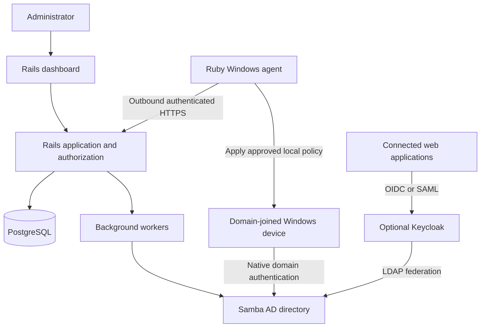

# VeyloraAccess

**One identity. Every company device.**

VeyloraAccess is a planned identity and access management platform for company-owned Windows devices. It brings employee accounts, device enrollment, access policies, and local permissions together in one administration interface.

The goal is for employees to sign in to Windows with their company identity, while administrators manage who can access each device and which permissions they receive.

The platform uses **Ruby on Rails**, and the Windows agent is also written in **Ruby**. The initial authentication design uses **Samba Active Directory** for native Windows domain sign-in.

> **Project status:** initial scaffold. The repository includes a Rails application shell, a Ruby agent diagnostic CLI, local development infrastructure, and CI definitions. Identity provisioning, enrollment, access enforcement, and Windows service hosting are not implemented. Runtime validation is still required; see [development setup](docs/development.md).

## Contents

- [Vision and scope](#vision-and-scope)
- [Technology stack](#technology-stack)
- [Architecture](#architecture)
- [Windows sign-in](#windows-sign-in)
- [Identity and data ownership](#identity-and-data-ownership)
- [Core workflows](#core-workflows)
- [Roles and permissions](#roles-and-permissions)
- [Ruby Windows agent](#ruby-windows-agent)
- [Security design](#security-design)
- [Offline behavior and revocation](#offline-behavior-and-revocation)
- [Proposed data model](#proposed-data-model)
- [Proposed API](#proposed-api)
- [Deployment](#deployment)
- [Development plan](#development-plan)
- [Roadmap](#roadmap)
- [Validation and acceptance criteria](#validation-and-acceptance-criteria)
- [Contributing](#contributing)
- [License](#license)
- [References](#references)

## Vision and scope

VeyloraAccess aims to provide a self-managed foundation for workforce identity and device access, inspired by the centralized administration offered by products such as Microsoft Entra.

The first release focuses on one organization and its Windows fleet. Multi-organization hosting, other operating systems, and advanced federation are later design decisions.

### Planned capabilities

- Manage employees, groups, and employment status.
- Provision and disable employee accounts in a domain directory.
- Enable native Windows sign-in using those domain accounts.
- Enroll company devices and maintain a device inventory.
- Assign access policies to groups and devices.
- Reconcile approved local Windows group memberships.
- Request, approve, and expire temporary administrator access.
- Record administrative changes, policy delivery, and device acknowledgments.
- Add web application single sign-on when needed.

### Initial boundaries

The MVP is a workforce identity and access product. Full endpoint management, operating system patching, antivirus, disk encryption management, and customer identity are separate projects or integrations.

Building this platform does not automatically reproduce every Entra, Intune, or Active Directory capability. Compatibility and security claims must be validated against the specific Windows editions and versions supported by the project.

## Technology stack

| Component | Planned technology | Responsibility |
| --- | --- | --- |
| Application backend | Ruby on Rails | Business workflows, authorization, agent API, provisioning, audit events |
| Admin interface | Rails views with Hotwire / Turbo / Stimulus | Employee, device, group, and policy management |
| Application database | PostgreSQL | Product records, policy state, device inventory, audit metadata |
| Background processing | Active Job with a durable queue adapter | Provisioning, retries, policy dispatch, scheduled reconciliation |
| Windows agent | Ruby | Device enrollment, inventory, policy application, status reporting |
| Windows service hosting | Service wrapper or native service integration, to be validated | Agent startup, shutdown, restart, and service identity |
| Windows authentication | Samba AD domain controllers | Domain identities, Kerberos, native Windows domain authentication |
| Windows integration | Windows APIs through Ruby bindings; tightly scoped PowerShell where necessary | Local group management and system operations |
| Optional web SSO | Keycloak federated with the directory | OIDC / SAML for connected web applications |
| Deployment | Linux VMs; containers for suitable application services | Rails, database connectivity, workers, and supporting services |

Ruby is the implementation language for both the application and the agent. The scaffold targets Ruby 3.4 and Rails 8.1, with Hotwire for the dashboard. Dependencies are declared separately for each component; resolve and commit their lockfiles with Bundler before treating builds as reproducible.

The Windows agent needs an early feasibility milestone: validate Ruby runtime packaging, Windows service lifecycle, privileged API access, and signed upgrades on a clean test VM before committing to a distribution approach.

## Architecture



Rails owns the administrative workflows and desired policy state. Samba AD provides the domain identities Windows authenticates. PostgreSQL holds application data rather than acting as a Windows credential database.

The Ruby agent initiates outbound connections to Rails, retrieves applicable policy, applies permitted device changes, and reports the result. The server must distinguish requested state from confirmed device state.

Domain connectivity and agent connectivity are separate requirements. A device reaching the Rails API does not prove it can reach a domain controller.

## Windows sign-in

### Initial approach: native domain authentication

1. An administrator creates an employee in VeyloraAccess.
2. A background job provisions the employee's account in Samba AD.
3. A company Windows device is joined to that domain through a controlled enrollment procedure.
4. The employee signs in using the Windows domain sign-in flow.
5. Windows establishes the employee's session and profile using the domain identity.
6. The Ruby agent applies device-specific permissions and reports policy status.

The initial scope requires a Windows edition that supports joining an AD domain. The supported edition/version matrix must be established during implementation; Windows Home is outside the initial domain-join scope.

Domain discovery depends on correct DNS, and Kerberos depends on appropriate time synchronization. Remote devices need a deliberate private-network or VPN design, including connectivity before the first domain sign-in where required. The Rails API is not a replacement for those services. See [Microsoft's domain join troubleshooting guidance](https://learn.microsoft.com/en-in/troubleshoot/windows-server/active-directory/active-directory-domain-join-troubleshooting-guidance).

### Optional branded sign-in

A branded Windows sign-in experience is a later research item. A custom Credential Provider collects and serializes credentials; Windows authentication components still validate them and create the session. It is not sufficient to add a Ruby agent or an OAuth login screen and treat that as Windows authentication.

Any custom Credential Provider would require separate native Windows integration and a security review. It is outside the Ruby-only MVP. Retain a tested system sign-in and recovery path if this feature is explored. See [Microsoft's Credential Provider documentation](https://learn.microsoft.com/en-us/windows/win32/secauthn/credential-providers-in-windows).

## Identity and data ownership

| Data | Authority |
| --- | --- |
| Domain account identifiers, authentication secrets, domain groups | Samba AD |
| Employee business metadata and lifecycle requests | Rails / PostgreSQL |
| Device enrollment identity and inventory | Rails / PostgreSQL, backed by device credentials |
| Desired access assignments and policy versions | Rails / PostgreSQL |
| Actual local permissions and sessions | Windows, observed through the agent |
| Optional web sessions and tokens | Web identity provider |

VeyloraAccess initiates account lifecycle changes and records their provisioning status. Failed directory writes must remain visible and retryable; the dashboard must not mark an account as active before provisioning succeeds.

Store immutable directory identifiers, including the relevant SID and object identifier, rather than mapping users by display name alone. Renaming an employee must preserve their existing domain identity and Windows profile. Deleting and recreating a user is not equivalent to renaming one.

Password operations belong to a narrowly scoped directory integration. Do not store employee passwords in PostgreSQL, queue payloads, logs, or agent configuration.

## Core workflows

### Employee onboarding

1. Create an employee and assign organizational groups.
2. Provision the directory account and record its immutable identifiers.
3. Complete secure initial credential setup through an approved directory flow.
4. Assign devices and sign-in policy.
5. Join and enroll the device through separate, traceable steps.
6. Confirm successful Windows sign-in and agent reconciliation.

### Device enrollment

1. An administrator issues a short-lived, single-use enrollment token.
2. An authorized installer installs the Ruby agent and its packaged runtime.
3. The agent exchanges the token for a unique device identity.
4. The device establishes authenticated communication with Rails.
5. Rails assigns the device to its approved scope and publishes a policy version.
6. The agent reports the applied version and any errors.

Agent enrollment does not implicitly join a machine to the domain. Domain join needs a separate permission model and confirmation step, even if both are eventually orchestrated by one setup tool.

### Temporary administrator access

1. An employee requests elevation for a specific device and duration.
2. An authorized approver reviews the reason and scope.
3. Rails creates an expiring assignment.
4. The agent applies the approved local group membership and schedules local expiry.
5. The agent removes the grant at expiry, including when the server is unavailable, and later reports the outcome.

Removing group membership does not retroactively remove privileges from an existing Windows access token. Session or process termination requirements need an explicit policy. Persistent administrator access is excluded from the default employee role.

### Employee offboarding

Disable the directory account, revoke application sessions and agent-side assignments, cancel pending elevation grants, and dispatch updated policy to affected devices. Track each action independently and show failures or unreachable devices.

An existing Windows session or cached offline sign-in may remain usable. Offboarding must report those limits instead of presenting a single successful directory write as complete device revocation.

## Roles and permissions

Application administration and Windows device permissions are separate authorization layers.

| Example application role | Intended scope |
| --- | --- |
| Organization administrator | Manage organization settings, administrators, and integrations |
| Identity administrator | Manage employees, groups, and lifecycle requests |
| Device administrator | Manage enrolled devices and device policies |
| Support operator | Inspect assigned devices and perform explicitly approved actions |
| Auditor | Read audit events and policy history |
| Employee | View assigned devices and request permitted access |

Device policy can grant standard use, access to a defined machine set, or temporary local administrator membership. A developer job title does not automatically imply local administrator access.

Enforce authorization in Rails on every request and scope database queries to the caller's permitted resources. Hiding a dashboard button is not authorization. Domain sign-in rights, local group membership, and application roles require explicit mappings and conflict rules.

For the MVP, define one owner for each managed setting: domain policy or the Ruby agent. Avoid having Group Policy and agent reconciliation repeatedly overwrite the same membership.

## Ruby Windows agent

The agent is a Ruby application running as a managed Windows service with only the privileges required for its operations. Privileged account and group changes may require a highly privileged service identity; isolate those operations and minimize the privileged code path.

### Planned responsibilities

- Generate and protect a per-device identity.
- Authenticate to the Rails API and rotate device credentials.
- Send device inventory, health, and policy acknowledgments.
- Retrieve versioned desired policy and reject stale or expired work.
- Reconcile only explicitly managed local permissions.
- Expire temporary grants locally and recover expiry state after restart.
- Maintain bounded offline state and retry transient failures with backoff.
- Install verified updates with a rollback and recovery strategy.

### Implementation constraints

- Package a pinned Ruby runtime and dependencies so users do not need a separate Ruby installation.
- Select and validate a maintained service-hosting approach before choosing its library or wrapper.
- Use stable SIDs for built-in groups instead of localized names such as `Administrators`.
- Prefer structured Windows API calls; constrain PowerShell fallbacks to fixed operations with validated parameters.
- Never expose an arbitrary shell-command endpoint through the control plane.
- Reconcile idempotently and preserve memberships the product does not own.
- Protect configuration, private keys, local state, and logs using Windows access controls.
- Validate distribution signing, installer permissions, service restart behavior, and recovery on supported Windows releases.

The agent's local database or state files are implementation details to choose after the packaging spike. A local administrator can tamper with local software; the agent must not be described as tamper-proof.

## Security design

Security controls below are implementation requirements, not claims about existing functionality.

- Require strong administrator authentication and MFA for the dashboard. Web MFA does not automatically add MFA to native Windows domain sign-in.
- Use TLS for all control-plane traffic and authenticated, encrypted directory connections.
- Use unique device credentials, with mutual TLS as the proposed enrollment target.
- Keep enrollment tokens short-lived, single-use, and scoped to an organization.
- Bind policy operations to a device, policy version, validity window, and operation identifier to prevent replay.
- Keep domain controllers private. Do not expose domain protocols directly to the public internet.
- Delegate only the required directory permissions to provisioning workers; do not run them as domain administrators.
- Store deployment secrets in an appropriate secret store and rotate credentials.
- Use Rails session security, CSRF protection for browser requests, API authentication, rate limits, and sensitive-field filtering.
- Record actor, target, action, timestamp, outcome, and correlation identifier for sensitive changes.
- Restrict modification of audit records and plan external retention or export before production.
- Verify agent update authenticity and integrity before installation.
- Maintain an audited, device-specific emergency recovery account with protected, rotated credentials.

Audit events must not contain passwords, private keys, enrollment secrets, or complete authentication tokens. Device inventory and employee data need documented retention and deletion policies.

## Offline behavior and revocation

Offline access is an explicit policy decision. Native Windows cached domain logon behavior must be configured and tested; the Ruby agent does not replace it with its own credential cache.

| Situation | Intended behavior / limitation |
| --- | --- |
| Rails API unavailable | Existing Windows authentication follows domain and local policy; agent retains validated state and retries |
| Domain controller unreachable | Existing users may sign in through Windows cached logon if configured; first sign-in generally requires domain connectivity |
| Device disconnected during offboarding | Server records revocation, but cannot promise immediate enforcement on the device |
| Temporary elevation expires offline | Agent removes its managed membership locally; existing tokens may retain privilege |
| Agent crashes or device restarts | Persist expiry state and reconcile immediately on restart; test failure cases explicitly |
| Device reconnects | Reconcile current state and submit outstanding audit results |

Define maximum policy staleness, recovery behavior, and whether to allow new elevation while offline before production. Local expiry depends on the service running and trustworthy time handling; clock changes and service stoppage belong in the threat model.

## Proposed data model

| Entity | Purpose |
| --- | --- |
| Organization | Initial deployment scope and configuration |
| Employee | Business identity, lifecycle status, directory identifiers |
| Group / GroupMembership | Organizational grouping and directory mapping |
| AdministrativeRole / RoleAssignment | Dashboard and API permissions |
| Device | Enrollment identity, assignment, platform, last contact |
| DeviceCredential | Public identity metadata, validity, rotation, revocation |
| Policy / PolicyVersion | Desired access rules and immutable revision history |
| DevicePolicyStatus | Desired, received, applied, or failed policy state |
| AccessRequest / ElevationGrant | Approval, device scope, duration, expiry |
| ProvisioningOperation | Idempotency, retries, directory results, failure details |
| AuditEvent | Attributed administrative and device activity |

Device private keys remain on the device. Avoid overloading a single role table with both application authorization and Windows group membership semantics.

## Proposed API

These routes illustrate the planned contract. They are not implemented endpoints. The scaffold exposes only `/` (public project status) and `/up` (application liveness).

| Method | Route | Purpose |
| --- | --- | --- |
| POST | `/api/v1/enrollments` | Exchange a one-time token for device enrollment |
| POST | `/api/v1/agent/heartbeat` | Report authenticated device health and inventory |
| GET | `/api/v1/agent/policy` | Retrieve policy scoped to the authenticated device |
| POST | `/api/v1/agent/policy_results` | Acknowledge policy application or failure |
| POST | `/api/v1/access_requests` | Request device-scoped temporary access |
| POST | `/api/v1/access_requests/:id/approve` | Approve within the caller's authority |
| POST | `/api/v1/employees` | Request employee creation and provisioning |
| POST | `/api/v1/employees/:id/disable` | Initiate tracked offboarding operations |

Agent identity determines device scope; a caller-supplied device identifier must not grant access. Mutations need authorization, validation, idempotency where appropriate, bounded payload sizes, and auditable outcomes. Enrollment requires token authentication even before device credentials exist.

## Deployment

The proposed deployment separates the Rails web process, durable background workers, PostgreSQL, and Samba domain infrastructure. Keycloak is optional and can be introduced when web SSO is needed.

- Run Rails and workers on Linux, with controlled access to the database and directory.
- Operate Samba domain controllers on dedicated infrastructure appropriate to their DNS and authentication requirements.
- Provide private routing or VPN access from managed Windows devices to domain services.
- Expose the Rails dashboard and agent API over HTTPS with their respective authentication controls.
- Monitor provisioning failures, queue health, stale devices, policy failures, certificate expiry, and backup status.
- Design domain redundancy and tested recovery before relying on the service for daily employee access.

PostgreSQL backup alone cannot restore domain identities. Plan separate recovery procedures for Samba, application data, secrets, certificates, and optional SSO state. Test the recovery order and preservation of identity identifiers.

Azure is an optional hosting destination. The proposed architecture does not require Azure or Entra, and selecting Rails does not determine the cloud provider.

## Development plan

See [docs/development.md](docs/development.md) for container and native Ruby setup, and [agent/README.md](agent/README.md) for the diagnostic CLI. The scaffold includes development configuration and tests, but no business database migrations. Ruby, Bundler, and Docker were unavailable on the scaffolding host, so boot and test execution remain to be verified in a configured environment.

### Repository layout

```text
VeyloraAccess/
├── README.md
├── .github/workflows/        # Rails and cross-platform agent CI
├── platform/                 # Rails shell, Hotwire, PostgreSQL configuration
├── agent/                    # Ruby diagnostic CLI and tests
├── infrastructure/           # Development image and infrastructure notes
├── docs/                     # Setup, architecture, Windows lab, decisions
├── compose.yml               # Local Rails + PostgreSQL services
├── CONTRIBUTING.md
└── SECURITY.md
```

The directories above exist. Domain integration, administrative authorization, durable workers, and Windows service packaging remain future implementation work.

### Initial lab

Use an isolated Linux environment for Samba and application services plus a disposable Windows VM with snapshots. Configure a test domain under a DNS namespace you control and validate DNS, time synchronization, and private routing before application integration.

Use synthetic accounts and a dedicated test directory. Do not point early provisioning or permission reconciliation code at a production domain.

### First end-to-end milestone

Create an employee through Rails, provision its Samba account, join a Windows test VM, sign in as that employee, and have the Ruby service report the device and apply one reversible local group assignment. Record each result in the dashboard.

## Roadmap

The initial repository scaffold is present. The functional phases below remain planned; none are marked as delivered.

### Phase 0 — Prove Windows and Ruby integration

- [ ] Package and run a Ruby agent as a Windows service.
- [ ] Verify privileged Windows API access and service recovery.
- [ ] Prove Samba domain join and native employee sign-in in a lab.
- [ ] Define supported Windows editions and versions.
- [ ] Document DNS, time, networking, and recovery requirements.

### Phase 1 — Rails identity foundation

- [ ] Initialize Rails, PostgreSQL, dashboard authentication, and authorization.
- [ ] Implement employees, groups, and tracked provisioning operations.
- [ ] Integrate account creation and disabling with least-privilege directory credentials.
- [ ] Add structured audit events and visible error states.

### Phase 2 — Device management MVP

- [ ] Implement one-time enrollment and per-device credentials.
- [ ] Add Ruby agent heartbeat and inventory.
- [ ] Deliver versioned policy with idempotent reconciliation.
- [ ] Manage explicitly owned local group memberships.
- [ ] Display stale devices and applied-policy status.

### Phase 3 — Temporary access and offboarding

- [ ] Implement approval-scoped elevation with durable local expiry.
- [ ] Handle reboot, clock changes, connectivity loss, and service interruption.
- [ ] Track directory disabling, session revocation, and device policy separately.
- [ ] Document cached logon and existing-session limitations.

### Phase 4 — Operational readiness

- [ ] Add administrator MFA and credential rotation.
- [ ] Deliver signed agent installation and upgrade artifacts.
- [ ] Validate rollback, emergency access, backups, and restoration.
- [ ] Perform security review and Windows compatibility testing.
- [ ] Publish deployment, incident response, and maintenance guides.

### Later options

- Keycloak-backed web SSO using directory federation.
- Additional device platforms with platform-specific enforcement.
- Multi-organization hosting after a dedicated isolation design.
- A branded Windows sign-in component after separate feasibility and security work.

## Validation and acceptance criteria

The MVP is complete only after an end-to-end lab demonstrates:

1. An authorized administrator creates an employee and observes successful directory provisioning.
2. That employee signs in to a domain-joined Windows device and retains the same profile after an account rename.
3. An enrolled Ruby agent authenticates with its own device credential and cannot read another device's policy.
4. Applying the same policy repeatedly produces the same intended permissions without removing unrelated access.
5. Temporary elevation expires across disconnects and restarts, with existing-token limitations documented.
6. Offboarding reports both successful actions and devices that have not acknowledged revocation.
7. Unauthorized API calls, reused enrollment tokens, and stale policy operations are rejected.
8. Recovery access and restoration are tested without losing employee identity mappings.

Use Rails authorization and integration tests, Ruby agent unit tests around policy decisions, and real Windows VM tests for service lifecycle, permissions, profiles, and offline behavior. Mocked APIs alone cannot establish Windows compatibility.

## Contributing

Start with a focused issue or change describing the user workflow, affected trust boundary, and expected behavior. Keep architecture decisions and implementation status aligned with this README.

Changes to authentication, enrollment, directory access, local administrator membership, or updates should include failure behavior and a recovery path. Never commit real credentials, private keys, employee exports, or domain backups.

## License

No project license has been selected or included yet. Choose and add a `LICENSE` file before describing this repository as licensed open-source software. Third-party components retain their own license terms.

## References

- [Ruby on Rails guides](https://guides.rubyonrails.org/)
- [Samba project documentation](https://www.samba.org/samba/docs/)
- [Microsoft: Windows authentication credential processes](https://learn.microsoft.com/en-us/windows-server/security/windows-authentication/credentials-processes-in-windows-authentication)
- [Microsoft: Credential Providers in Windows](https://learn.microsoft.com/en-us/windows/win32/secauthn/credential-providers-in-windows)
- [Microsoft: domain join troubleshooting](https://learn.microsoft.com/en-in/troubleshoot/windows-server/active-directory/active-directory-domain-join-troubleshooting-guidance)
- [Keycloak server administration and LDAP federation](https://www.keycloak.org/docs/latest/server_admin/index.html)
